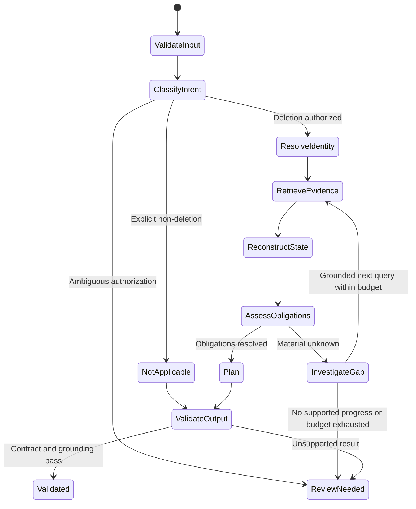

# Agent Design

Date: 24 October 2026 · Status: proposed design, not implemented

## Role and authority

The deletion audit investigator determines what the supplied evidence supports at an audit timestamp. It may inspect, correlate, request targeted extraction, and propose remediation. It cannot perform remediation, change policy, silently merge uncertain identities, or use expected answers.

Use one coordinator with specialized task handlers: authorization interpreter, evidence extractor, identity resolver, timeline reducer, policy assessor, planner, and validator. These are code responsibilities and bounded model tasks, not a requirement for multiple autonomous agents. This makes replay, provenance and cost accounting easier to control.

## Case state machine

Processing state is distinct from deletion verdict. `review_needed` never becomes a fourth CSV verdict. A demonstrated violation can establish `INCOMPLETE`, but missing evidence may still prevent a complete remediation plan; track those separately. Unknown-only cases cannot be labeled incomplete by inventing violations.

## Read-only tool contracts

| Internal tool | Input | Output and restrictions |
|---|---|---|
| resolve_subject | Request email, audit cutoff | Candidate subject and eligible identity edges; ambiguity explicit |
| lookup_observations | Typed identifiers/resources, cutoff, allowed scope | Eligible observations and source locators |
| inspect_source | Evidence ID, bounded locator | Source region and metadata; only dataset-root paths |
| inspect_snapshot | Registered snapshot ID and predefined query type | Bounded rows and scope; no free-form model SQL |
| extract_region | Source ID, page/region, typed question | Candidate facts with provenance and extraction diagnostics |
| expand_dependencies | Resource IDs and cutoff | Grounded upstream/downstream/process edges |
| assess_obligations | Established facts and policy version | Satisfied, violated, unresolved obligations |
| validate_plan | Candidate verdict/steps and obligation references | Errors, coverage gaps and citation checks |

The coordinator owns tool scheduling and budgets. It validates references before calling handlers and preserves errors rather than converting them into empty results.

## Investigation loop

For every unresolved obligation, record a specific question, such as “Does this regional replica retain the old email?” Choose a grounded query from known identifiers/resources. Inspect the result, add supported observations, and reassess only affected obligations. Stop when the relevant frontier is exhausted and all material obligations are resolved, or route to review when evidence is insufficient.

Detect repeated queries by normalized arguments and index version. Repeated no-progress results do not justify another unbounded loop. Store checkpoints so a run can resume without duplicating observations or steps.

## Finalization invariants

- Non-deletion cases contain no deletion findings, actions, or checks.
- Every included resource has a grounded subject relationship.
- Every current-state claim uses eligible evidence for the correct store scope.
- Required retained records have presence obligations; forbidden identifiers have treatment obligations.
- Active recreation risks are controlled before record mutations in the prescribed action order.
- Incomplete-case future steps have empty evidence IDs; complete-case checks cite proof.
- Output order and numbering are generated from the contract, not from model prose.
- Final export fails visibly if any required case remains materially unresolved.

## Review escalation

Provide the reviewer with the unresolved question, relevant sources, conflict or extraction error, attempted queries, and affected obligations. Any reviewer decision must record its basis and provenance. Do not create a synthetic evidence ID and present it as supplied evidence. A decision unsupported by challenge-visible proof must remain a documented limitation.
