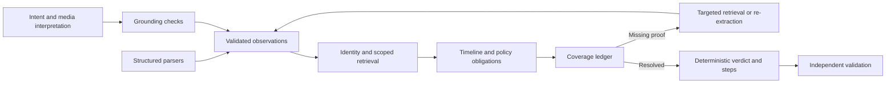

# AI Architecture

Date: 24 October 2026 · Status: proposed design, not implemented

## Decision

Use a controlled investigation pipeline with targeted model calls. The model interprets language and difficult evidence; validated code owns policy evaluation, temporal eligibility, final decisions, and output formatting. Start with one logical investigator coordinated by code. Separate model tasks do not require autonomous agents or independent services.

The model/provider is intentionally undecided until evaluated. Compare candidates on intent, extraction grounding, difficult media, latency, and cost. Do not select by general model reputation alone.

## Boundaries

| Task | Primary mechanism | Model involvement |
|---|---|---|
| CSV/JSON/SQL parsing | Structured readers | None for valid structured fields |
| Multilingual authorization | Semantic classifier | Typed intent and quoted supporting span |
| PDFs/screenshots/noisy prose | Text/OCR plus targeted interpretation | Extract candidate facts and source regions |
| Identity joins | Exact normalized keys and dated identity edges | Suggest ambiguous links for validation only |
| Temporal reconstruction | Scope-aware observation reducer | Explain conflicts or request missing evidence |
| Policy decisions | Supplied rules and validated conditions | Propose condition interpretation when prose is ambiguous |
| Recreation analysis | Grounded dependency edges | Extract relationships from narrative evidence |
| Final status and steps | Obligation engine and deterministic planner | No unrestricted verdict generation |
| Human-readable explanation | Templates or optional summarization | Must reference established facts only |

## Processing flow

## Retrieval strategy

Begin with exact current/historical identifiers, stable user references, and resource IDs. Expand through explicit ownership, trace, and dependency edges until no supported new relevant resource appears. Record why every resource belongs to the case. A shared artifact is not evidence that all its records belong to the same person.

Apply artifact availability, observation time, and identity-edge availability filters before model context construction. Search query parameters are discovery metadata, not automatically retained record contents. Semantic retrieval may help find narrative context later, but must never establish ownership by similarity alone.

## Grounding and conflict handling

Each candidate fact includes a source ID, locator, observation time, store scope, typed value, and evidence kind. Validate source existence and eligibility, then check support against the referenced content. Literal span checks catch some hallucinations but do not establish semantic correctness; ambiguous interpretations remain unresolved.

Do not rank evidence using a single global confidence score. Consider directness, scope, time, and whether the evidence represents an attempted operation or observed state. Newer primary evidence cannot supersede an older replica observation without evidence about that replica. Preserve competing observations and a machine-readable resolution reason.

## Model controls and accounting

Inputs are explicit task envelopes. Evidence is untrusted data and cannot issue commands. Model output must match a schema with bounded item counts and explicit unknown fields. No arbitrary SQL, shell, network access, or deletion tools are exposed to the model.

Suggested configurable starting limits: one initial model call per semantic task, at most one repair/re-extraction call, and two investigation expansion rounds per unresolved case. Reaching a limit triggers review rather than guessing. These are proposed budget controls, not measured optimal settings.

Log provider/model/version when available, prompt version, context hashes, actual usage, timing, and retry count. Estimate cost from an explicitly dated pricing configuration; report unavailable usage as unavailable, never zero. Report actual zero when no call occurs. Development-chat usage is distinct from inference-run usage.

## Evaluation before model selection

Compare deterministic-only, model-assisted, and general model baseline runs using identical eligible evidence. Measure intent accuracy, fact extraction precision/recall on authored annotations, citation support, false-complete decisions, policy safety, latency, and cost. Keep public sample labels out of prompts and caches. Choose the simplest approach that meets the PRD gates.

See [Agent Design](AGENT_DESIGN.md), [Prompt Engineering](PROMPT_ENGINEERING.md), and [System Architecture](SYSTEM_ARCHITECTURE.md).
