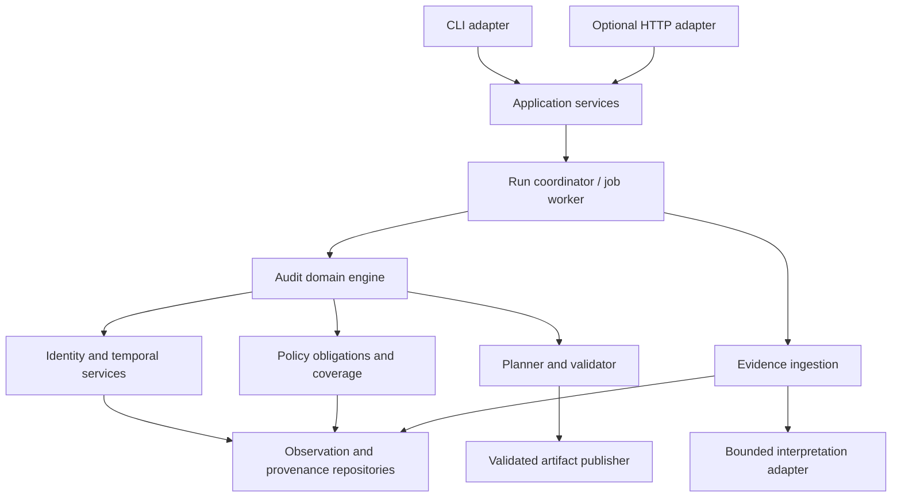

# Backend Design

Date: 24 October 2026 · Status: design only

## 1. Purpose and deployment boundary

The backend turns supplied files into validated audit results. Its core must run locally through the CLI without a web server. A future HTTP adapter exposes the same services to the reviewer workspace.

Start with a modular application and local database. Separate long-running audit work from HTTP request handling if the web layer is built. A local worker can serve the initial workspace; external queues, multiple workers and a server database require demonstrated operational need. No backend code or infrastructure is implemented here.

## 2. Layers and dependencies

Domain logic does not depend on an HTTP framework or model provider SDK. Application services coordinate transactions and work; adapters handle filesystem, database, media extraction and model calls. The web layer never implements a second policy engine.

## 3. Service ownership

| Service | Responsibility | Result |
|---|---|---|
| Dataset registry | Validate manifest paths, hashes and required inputs | Immutable dataset version |
| Ingestion service | Parse artifacts, record extraction attempts and provenance | Indexed observations and visible failures |
| Identity service | Resolve subject and historical identifiers with eligibility | Grounded identity references or ambiguity |
| Investigation service | Retrieve relevant records, expand dependencies and resolve gaps | Case evidence set and scope |
| Reconstruction service | Reduce observations at cutoff within store scope | Established state and unresolved conflicts |
| Policy service | Evaluate supplied conditions and treatments | Satisfied/violated/unresolved obligations |
| Planning service | Determine supported verdict and ordered steps | Candidate result with evidence relationships |
| Validation service | Enforce exact schema, citation eligibility and coverage | Validated case/run or errors |
| Reporting service | Produce readable explanations, metrics and actual usage | Versioned run reports |
| Artifact service | Publish validated output atomically | Artifact hash and run association |

Detailed logical tables remain in DATABASE_DESIGN.md; endpoint contracts remain in API_DESIGN.md.

## 4. Run lifecycle

1. Validate input paths, request uniqueness and configuration. Register input hashes, code/config versions and policy version.
2. Ingest or reuse compatible validated extractions. Store extraction failures explicitly.
3. Create per-case processing records. Establish intent before subject-level deletion investigation.
4. Resolve identity and gather eligible evidence. Reconstruct state and assess obligations.
5. Investigate material gaps within configured budgets. Route unresolved cases to review without manufacturing a CSV verdict.
6. Generate and validate each resolved case result. Keep results linked to their evidence and obligations.
7. Validate global case coverage, ordering, citations and complete output structure.
8. Publish the CSV and reports only when the final run meets the export gates. Expose provisional case reports separately.

Run progress represents completed work counts and named stages, not an invented overall percentage. Report case and extraction counts separately because one shared artifact can affect many cases.

## 5. Work scheduling and transactions

Use immutable input versions and idempotent stage operations. Uniqueness keys prevent duplicate source extraction records, case attempts and final steps. Where a worker may retry, design operations for at-least-once execution with deduplication; do not promise exactly-once processing.

Keep database transactions short. Do not hold a transaction while invoking a model or parsing a large document. Record an attempt, perform bounded work, then commit validated observations and attempt outcome atomically. A worker interruption leaves recoverable attempt state.

If multiple workers are later introduced, use job claims with leases and retry ownership. With SQLite, coordinate writes through a controlled writer and bounded transactions. Do not assume the local-store design scales unchanged to arbitrary concurrency.

## 6. Failure and retry design

| Failure | Handling |
|---|---|
| Malformed or missing mandatory input | Fail run setup with a specific corrective message |
| Transient model/service error | Bounded retry with backoff and accounting |
| Invalid model schema | One configured repair attempt, then unresolved extraction |
| Unsupported source format or unreadable region | Record gap and affected scope; never treat as absent data |
| Conflicting identity/state | Targeted investigation or review-needed state |
| Model budget exhausted | Preserve checkpoint and unresolved questions |
| Final output invalid | Do not publish; preserve prior artifact and report validation errors |
| Retry with changed inputs | Require a new run/version instead of silently changing the old run |

Distinguish an established violation from insufficient evidence. An incomplete verdict still needs a complete supported plan before final export. The contract's missing `UNKNOWN` status and missing action for recreating a lost retained record remain explicit limitations requiring resolution.

## 7. Backend/frontend contract

Responses carry run/result versions, processing state, nullable provisional verdict, established counts, issue codes and source references. The backend computes plan order, coverage summaries and export readiness. Keep source locators internal or authorized; never return arbitrary filesystem paths.

Case reports use concise facts and policy explanations. Do not expose raw private model reasoning. Evidence excerpts are fetched on demand, authorized against the case's grounded evidence set, and bounded to prevent accidental whole-corpus disclosure.

The optional API returns an accepted job reference for audit creation. Browser disconnects do not cancel work. Retry and final export behavior follow API_DESIGN.md. No endpoint executes deletion or changes source records.

## 8. Security and data handling

Constrain source paths to the dataset root, including resolved paths. Process supplied SQL in an isolated environment with restricted capabilities. Treat PDFs, images, archives and logs as untrusted inputs with size/time/resource limits. Do not execute document content or commands suggested by the model.

Use a restricted workspace for derived artifacts and temporary files. Keep source corpus immutable. Minimize replicated PII, redact routine diagnostics, and separate model credentials from code and reports. Derived caches and indexes remain linkable data and require an explicit lifecycle.

For a hosted workspace, authenticate callers and enforce ownership/tenant scope in every repository query and artifact access. UI visibility is not authorization. Restrict cross-origin access and protect browser-authenticated mutations against request forgery as appropriate to the chosen authentication design. Authentication/provider selection remains open until the web deployment is selected.

## 9. Observability and reproducibility

Use run ID, case ID, task ID, source ID and attempt ID as correlation references. Log stage transitions, durations, retry reasons and validation failures without unnecessary identifiers. Track actual model calls/tokens and clearly separate missing usage from zero usage.

Pin source hashes, policy version, prompt/schema/extractor versions, configuration and code revision. Checkpoints are reusable only when their dependencies match. Reports identify their run and output hash; stale artifacts must not be presented as current results.

## 10. Backend acceptance scenarios

- CLI and optional HTTP adapter invoke the same domain service and produce equivalent results for the same pinned inputs.
- A retry does not duplicate steps, observations, costs already recorded, or final artifacts.
- A changed dataset cannot reuse stale case assessments.
- A post-cutoff observation is excluded even when already cached.
- A worker interruption can resume without converting partial extraction into successful absence.
- Every emitted step has a valid policy/evidence relationship and correct temporal scope.
- A failed run leaves the previous final output intact and identifies it as belonging to the previous run.
- A future web caller cannot access another scope's cases or source excerpts by changing an ID.

These are planned checks. Implementation and test results remain pending.

## 11. Implementation boundary

First implement the local audit core, ingestion, storage, CLI, reports and evaluation. Build the optional server and frontend against stable result contracts only after the evidence engine passes its correctness gates. Infrastructure and web-stack choices remain implementation decisions requiring targeted verification when selected.

See [System Architecture](SYSTEM_ARCHITECTURE.md), [Database Design](DATABASE_DESIGN.md), [Agent Design](AGENT_DESIGN.md), and [Frontend Design](FRONTEND_DESIGN.md).
