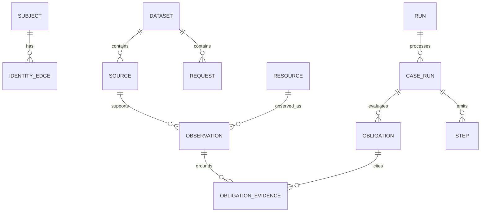

# Database Design

Date: 24 October 2026 · Status: proposed logical schema

## Choice and boundaries

Use SQLite locally for the MVP observation index and run state. Keep original evidence read-only outside the index. No server database is required by the challenge. A future multi-user service could migrate the logical model to a server database after concurrency and access requirements are established.

Dataset/run identifiers prevent accidental mixing of different corpora. Source evidence IDs are unique within a dataset, not assumed globally unique. Case IDs and resource IDs receive the same scoping treatment.

## Logical tables

| Table | Primary key | Important fields and relationships |
|---|---|---|
| datasets | dataset_id | manifest hash, identity/activity hashes, created time |
| policy_versions | policy_id | dataset_id, CSV hash, parsed version |
| policy_rules | policy_id + rule_id | category, condition text, required action |
| requests | dataset_id + case_id | email, request text, requested/audit times, reported fields |
| subjects | dataset_id + subject_id | supplied stable user reference |
| identity_edges | edge_id | dataset_id, subject_id, type, normalized value, valid_from/to when known, available_at, evidence ID/locator |
| sources | dataset_id + evidence_id | source kind, registered path/CSV row, captured/available time, content hash, origin |
| extraction_attempts | attempt_id | source reference, extractor/prompt/model versions, region, outcome, error, usage reference |
| resources | resource_key | dataset_id, system_id, external resource_id; unique over those three |
| observations | observation_id | resource_key, source reference, attempt_id, observed_at, available_at, scope, evidence kind, typed facts payload, locator |
| observation_links | link_id | observation_id, subject_id or identity_edge/resource reference, role, provenance |
| dependency_edges | dependency_id | source/destination resource keys, process resource, relation type, observation_id |
| runs | run_id | dataset_id, policy_id, code/config hashes, status, start/end, output hash |
| case_runs | run_id + case_id | processing state, intent, nullable verdict, unresolved count, error |
| obligations | obligation_id | run/case, resource/scope, rule ID, required state, assessment, reason code |
| obligation_evidence | obligation_id + observation_id + role | supports/contradicts/discovers relation |
| steps | run_id + case_id + step_no | phase, system/resource, operation/state, nullable evidence ID, internal obligation reference |
| investigation_queries | query_id | run/case, normalized query hash, input refs, outcome, budget counters |
| model_calls | call_id | run/task, provider/model, prompt hash, input/output tokens nullable, retries, timing, cost/config reference |
| checkpoints | run_id + case_id + stage | input hashes, versioned state, updated time |

Use a unified source registry for `file_id`, `activity_id`, and `audit_id`. Activity and audit CSV rows are sources with their own timestamps and locators. The final exporter converts internal null evidence references to the contract's empty string for future steps.

## Relationships



## Temporal semantics

Store canonical UTC timestamps using one sortable representation and parse/validate on ingestion. Keep event/observation time distinct from source availability/capture time. Unknown validity bounds stay null, not fabricated timestamps. A record's `updated_at` is not automatically the snapshot's readback time; adapters must interpret those fields explicitly.

Example retrieval contract:

```sql
SELECT o.*
FROM observations AS o
JOIN sources AS s
  ON s.dataset_id = o.dataset_id AND s.evidence_id = o.evidence_id
WHERE o.dataset_id = :dataset_id
  AND o.resource_key = :resource_key
  AND o.available_at <= :audit_at
  AND s.available_at <= :audit_at
  AND o.observed_at <= :audit_at;
```

The logical schema includes dataset_id on observations for this scoped query. Rows with unknown material timestamps require explicit handling rather than passing the predicate by default. State reduction partitions by scope; do not select one latest row across all replicas.

## Indexes and integrity

- Identity lookup: `(dataset_id, identifier_type, normalized_value, available_at)`.
- Resources: unique `(dataset_id, system_id, external_resource_id)`.
- Observations: `(dataset_id, resource_key, scope, observed_at, available_at)` and source reference.
- Case outputs: `(run_id, case_id, step_no)` unique and ordered.
- Dependency lookup: source/process/destination resource keys with dataset scope.
- Enable foreign keys; enforce dataset/run consistency with composite references where appropriate.
- Enforce allowed status/phase/operation/state enums, plus cross-field checks in application validation.
- Preserve immutable observations and extraction versions; derived results belong to a run and can be rebuilt.

Evidence IDs alone do not prove that an observation supports a step. Validate the obligation-evidence relationship and cutoff before export. Consecutive numbering and complete case coverage are checked across the result set, not just with row-level constraints.

## Migration and transaction plan

Maintain schema versions and transactional migrations. Ingest each source atomically; record failures without inserting incomplete successful observations. Commit case checkpoints and final plan rows transactionally. Publish a run only after global validation, then export atomically.

Do not include the runtime database, extraction caches, or copied corpus in code.zip. Rebuild them from supplied inputs on a clean run. The table design is a plan; no database migration has yet been implemented.
