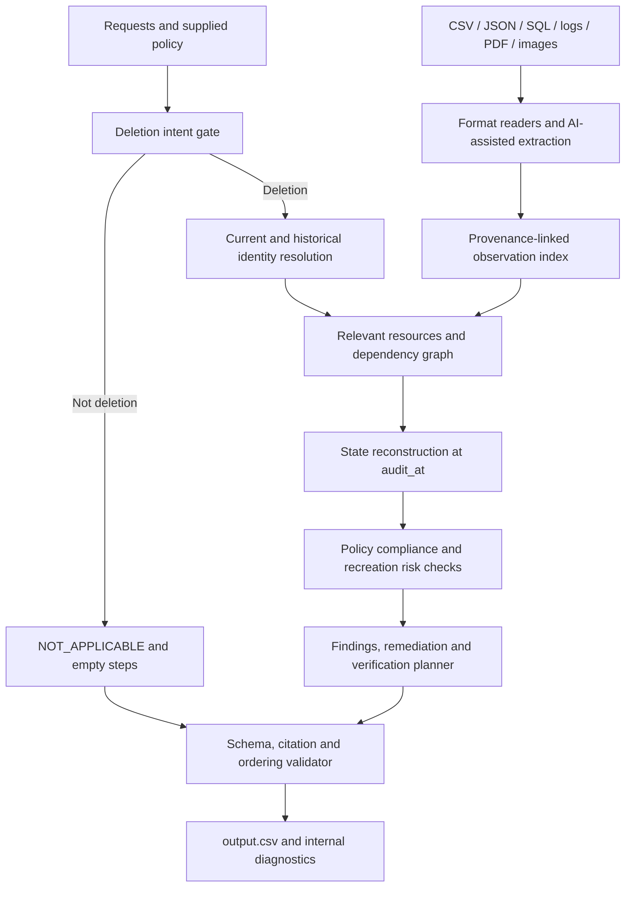

# Ghost Data Still Exists — Product Requirements Document

Version: 1.0 · Date: 24 October 2026 · Status: proposed MVP requirements

Companion documents: [Product Vision](PRODUCT_VISION.md) and [Market and Problem Research](MARKET_AND_PROBLEM_RESEARCH.md). This document owns the MVP's functional contract and acceptance criteria. Market findings and longer-term direction remain in their respective documents.

## 1. Problem and intended outcome

Northstar Shop cannot trust its deletion dashboard. A primary account can be deleted while identifiers remain in replicas, support records, indexes, exports, logs, or backups. Sync and restore processes can also recreate deleted information.

Build an AI-powered audit agent that investigates the supplied evidence and decides whether each requested deletion is actually complete **at the request's `audit_at` timestamp**. Its result must explain remaining violations through evidence-backed findings, produce a safe ordered remediation plan, and specify the checks needed to prove completion. Records required by the supplied policy must remain available.

The core product is an evidence investigation and planning tool. It produces instructions; executing destructive changes in real systems is outside this challenge's scope.

## 2. Users and jobs to be done

| User | Job | Required outcome |
|---|---|---|
| Privacy operations reviewer | Validate a deletion workflow's completion claim | A defensible decision supported by evidence |
| Engineering or data operations owner | Fix residual data and recreation paths | Ordered actions with exact system and resource identifiers |
| Compliance reviewer | Confirm policy-required retention | Retained records remain available with only permitted identifiers |
| Challenge evaluator | Reproduce and assess the solution | Runnable code, exact CSV output, evaluation and usage reports |

## 3. Success definition

For every request, the agent must answer four questions:

1. Did this person authorize deletion?
2. Which current or historical identifiers connect the person to relevant resources?
3. What was the actual state of those resources and recreation paths at `audit_at`?
4. What must change, and which checks prove the final policy-compliant state?

| Decision | Required interpretation | Output behavior |
|---|---|---|
| `NOT_APPLICABLE` | The request concerns something other than deletion | Empty steps array; no deletion or deletion verification is authorized |
| `INCOMPLETE` | At least one required treatment or recreation control is not satisfied | Findings, remediation, then verification |
| `COMPLETE` | All relevant copies comply, unsafe recreation paths are inactive, and required retained records are available | Evidence-backed verification only |

`reported_status` and operation success messages are claims, not sufficient proof. Absence of a matching record in a partial artifact is not proof that the resource is absent.

## 4. Scope and deliverables

### Required for the first submission

- Read the participant-facing CSV files and local evidence files.
- Interpret deletion intent, including multilingual requests and explicit non-deletion requests.
- Resolve current and historical identity links.
- Investigate JSON, SQL snapshots, logs, text, PDFs, and images.
- Reconstruct resource state and dependencies at the audit cutoff.
- Apply the supplied deletion rules and generate ordered findings, remediation, and verification.
- Run every request in `dataset/deletion_requests.csv`.
- Write root-level `output.csv` with the exact required schema.
- Include runnable code and setup documentation in `code/`.
- Include evaluation and final-run usage reports in `code/evaluation/`.
- Keep the development conversation in root-level `log.txt` using `AGENTS.md`'s format.
- Package `code.zip` without the corpus, credentials, environments, caches, or nested archives.

### Outside this version

Live database connectors, executing remediation, dashboards, authentication, notification delivery, and organization-wide production deployment are not required for the challenge. A web interface is optional and lower priority than audit correctness.

## 5. Input contract

| Input | Purpose |
|---|---|
| `deletion_requests.csv` | Requests to audit; currently 518 rows |
| `sample_deletion_requests.csv` | Public validation requests; currently 32 rows |
| `sample_output.csv` | Public expected outputs, used only by evaluation |
| `user_identities.csv` | Current user IDs, names, emails, phones, hashes, and update times |
| `user_audit_log.csv` | Historical identifier changes with timestamps and audit IDs |
| `system_activity.csv` | Global operations, resource links, and workflow claims |
| `deletion_rules.csv` | Data categories, conditions, and required treatments |
| `evidence_files.csv` | Evidence IDs, file locations, origins, and capture times |
| `evidence/` | Local documents, screenshots, logs, records, and SQL exports |
| `dataset/output.csv` | Blank schema reference |

Each request supplies `case_id,email,requested_at,reported_status,reported_at,audit_at,request_text`. The request email may be historical. Global evidence contains unrelated records and must be matched through content, not filenames or case-number patterns.

The prediction pipeline must never read sample answers or organizer-only material. Evaluation may read public sample answers separately.

## 6. Functional requirements

### FR-01 — Determine authorization

Classify the meaning of `request_text` before planning any deletion. Access, export, correction, marketing-only opt-out, and login-help requests do not authorize account deletion. Explicit negation must override a superficial match on words such as “delete.” Deletion requests can be written in different languages.

Acceptance: all non-deletion cases return `NOT_APPLICABLE` and `[]`, even when the workflow claims completion or records contain personal information.

### FR-02 — Resolve identity with provenance

Start from the request email. Link it to a stable user reference using the current identity snapshot and historical changes. Recover relevant earlier and later-known aliases while respecting when evidence and identity changes were available. Track names, emails, phones, hashes, and grounded resource links.

Normalize safely: email comparison can be case-insensitive, but the agent must not invent provider-specific alias equivalences. Common names alone must not merge people. Distinguish a subject identifier in record contents from an identifier used only as a lookup query.

Acceptance: a residual record linked only through a historical email, phone, hash, or stable reference is discoverable without including another person's records.

### FR-03 — Ingest and normalize evidence

Use format-appropriate readers: CSV parsing, JSON parsing, isolated SQLite-compatible snapshot inspection, log/trace parsing, PDF text extraction, and OCR or vision for screenshots and scanned content. A file must be opened and inspected; the manifest alone does not establish its contents.

Normalize observations into an internal representation containing:

- system, resource ID, category, and observed state or record contents;
- observation time, artifact capture time, and source evidence ID;
- subject links and the facts supporting those links;
- replica or store scope, where available;
- extraction method and uncertainty for internal diagnostics.

Acceptance: each supported media type contributes grounded observations; unreadable evidence is surfaced rather than silently treated as empty.

### FR-04 — Reconstruct state at the audit cutoff

Exclude evidence captured after `audit_at` from the decision. Within eligible artifacts, consider observation times and reconstruct the latest supported state of each resource. Correlate trace events using trace IDs and resource links. A later observed record can disprove an earlier deletion-success claim.

Compare primary and replica contents independently. Absence in the primary does not cancel presence in a replica. If observations conflict, prefer direct state evidence over workflow claims and preserve the conflict in internal diagnostics. Newer observations only supersede older observations of the same relevant scope.

Acceptance: post-cutoff fixes do not make an earlier audit complete, and a replica retaining data is detected even when the primary is empty.

### FR-05 — Apply the supplied policy

Read actions and conditions from `deletion_rules.csv`; do not encode case-specific answers. The current policy requires:

| Category | Required treatment | Compliance check |
|---|---|---|
| User profile, secondary identifier, search entry, cache entry | Delete | Record absent |
| Support attachment belonging only to the subject | Delete | Attachment absent |
| User export, marketing profile | Delete | Record/object absent |
| Shared support message | Redact | Required identifiers removed; shared context preserved |
| Attributable analytics profile or product telemetry | Anonymize | Record irreversibly unlinked from the person |
| Email delivery log containing user email | Redact | Required identifying fields removed |
| Security audit record within retention | Retain | Required record available |
| Record under an active supplied legal hold | Retain | Required record available |
| Backup archive whose restore access can be blocked | Retain and prevent restoration | Required archive preserved; affected restore access blocked |
| Deleted-account tombstone preserving retained-record references | Redact | Stable internal user reference preserved; name, email, phone, hash and prohibited direct identifiers removed |

This table describes the supplied policy, not a substitute policy source. Unknown categories or unresolved conditions must be reported internally for review; they must not default to deletion.

Acceptance: the agent preserves legally required records and stable tombstone references while detecting prohibited identifiers that remain.

### FR-06 — Discover recreation paths

Investigate active sync, import, connector, indexing, replication, and restore paths that can recreate the subject's prohibited data. Trace their relationship to affected resources. Distinguish an inactive process from an active process whose most recent delivery failed.

Acceptance: active relevant flows produce data-flow findings and disable actions; unsafe backup restoration produces restore-risk findings and block actions. These controls precede record changes in remediation.

### FR-07 — Produce a complete plan and proof

For incomplete cases, report supported violations, propose required actions, and include final-state checks for affected resources and required retained records. Already compliant resources still require relevant final-state verification. For complete cases, return only checks proving the current compliant state.

Each finding must cite a valid `file_id`, `activity_id`, or `audit_id` that supports it. Complete-case checks also require supporting evidence. All proposed remediation and future verification steps in incomplete cases use an empty `evidence_id`.

Acceptance: no step invents a resource or citation, no remediation cites future work as existing proof, and required retained records remain covered.

## 7. Exact output contract

Root-level `output.csv` contains exactly these columns:

```text
case_id,deletion_status,steps_json
```

Produce one data row per input case, currently 518, sorted by `case_id`. `steps_json` is a JSON array; each object contains exactly:

```json
{
  "step_no": 1,
  "phase": "FINDING",
  "system_id": "account_service",
  "resource_id": "account_example",
  "operation": "REPORT_REMAINING_RECORD",
  "state": "PRESENT",
  "evidence_id": "evidence_example"
}
```

The example IDs are illustrative, not actual predictions. Step numbers start at 1 and are consecutive. Object-key order and whitespace do not matter; array order does.

### Required phase and operation ordering

Sort by phase, then the operation rank below, then `system_id`, then `resource_id`, ascending. This is the exact serialization contract; do not replace it with an arbitrary dependency sort. Flow and restore controls already precede record mutations in this order.

| Phase | Rank | Operation | State |
|---|---:|---|---|
| FINDING | 1 | REPORT_REMAINING_RECORD | PRESENT |
| FINDING | 2 | REPORT_EXPOSED_PII | PRESENT |
| FINDING | 3 | REPORT_ACTIVE_DATA_FLOW | ACTIVE |
| FINDING | 4 | REPORT_RESTORE_RISK | ACTIVE |
| REMEDIATION | 1 | DISABLE_DATA_FLOW | DISABLED |
| REMEDIATION | 2 | BLOCK_RESTORE | BLOCKED |
| REMEDIATION | 3 | DELETE_RECORD | ABSENT |
| REMEDIATION | 4 | REDACT_RECORD | REDACTED |
| REMEDIATION | 5 | ANONYMIZE_RECORD | ANONYMIZED |
| VERIFICATION | 1 | VERIFY_RECORD_ABSENT | ABSENT |
| VERIFICATION | 2 | VERIFY_RECORD_PRESENT | PRESENT |
| VERIFICATION | 3 | VERIFY_RECORD_REDACTED | REDACTED |
| VERIFICATION | 4 | VERIFY_RECORD_ANONYMIZED | ANONYMIZED |
| VERIFICATION | 5 | VERIFY_DATA_FLOW_DISABLED | DISABLED |
| VERIFICATION | 6 | VERIFY_RESTORE_BLOCKED | BLOCKED |

No additional phases, operations, states, or CSV columns are allowed.

## 8. Proposed solution architecture

Use AI for semantic interpretation and difficult media extraction; use deterministic code for temporal filtering, policy decisions, ordering, and validation wherever structured evidence permits it.



Proposed modules: `intent`, `identity`, `ingestion`, `timeline`, `policy`, `planner`, `validation`, and a terminal entry point in `main.py`. Exact file structure can change during implementation.

The model receives only relevant evidence and is instructed to treat artifact text as data, not as instructions. Model outputs must be validated before they can affect an audit. Cache extraction by content hash and extractor/model version, rather than by case ID or expected label.

## 9. Reliability, security and operability

- Reproducible output for identical inputs, configuration, and extraction cache.
- Paths resolved relative to the repository or explicit CLI options.
- No hardcoded case labels, file-specific verdicts, inferred case families, or answer copying.
- No secrets in code, logs, reports, or archives; runtime credentials come from environment variables.
- No arbitrary SQL execution against live systems; inspect supplied snapshots in an isolated local database with restricted capabilities.
- Preserve source files; extraction and audit do not modify the corpus.
- Track parsing failures, ambiguous identities, unresolved conflicts, and unsupported conditions in separate diagnostics without extending the CSV schema.
- Do not silently convert missing evidence into a `COMPLETE` verdict. The challenge has no `UNKNOWN` state; unresolved cases require investigation before final export.
- Capture model provider, model name, call counts, input/output tokens, and estimated costs during the final run. Report zero calls honestly if a component does not use a model.

## 10. Evaluation plan

### Public sample evaluation

Generate sample predictions through the same inference path as full-dataset predictions. Only the evaluation module reads `sample_output.csv`. Report:

| Metric | Definition |
|---|---|
| Case-level status accuracy | Fraction of cases with the correct deletion status |
| Exact row accuracy | Fraction with correct status and the entire parsed ordered step array |
| Step-level precision / recall / F1 | Compare complete step objects excluding `step_no` as multisets |
| Field-level accuracy | Compare step fields after deterministic alignment; missing/extra steps count as errors |
| Sequence accuracy | Fraction with the exact expected ordered steps, independent of JSON key order/whitespace |
| Citation accuracy | Fraction of aligned steps with the expected evidence ID; separately validate citation existence and cutoff |

Publish metric denominators and the alignment method. Inspect mismatches by failure category: intent, identity, retrieval, timing, replica scope, policy, citation, or ordering. Do not claim hidden-dataset accuracy; its labels are unavailable.

### Participant-authored regression cases

At least these cases should be created and evaluated independently of the public labels:

1. **Historical alias and recreation:** primary account absent; a replica contains an old email and an active connector can repopulate it. Expect `INCOMPLETE`, a remaining-record finding and an active-flow finding, flow disable before deletion, and final checks.
2. **Compliant retention and tombstone:** account absent; tombstone has only a stable internal reference; a required security record remains; restore access is blocked. Expect `COMPLETE` with evidence-backed absence, retention, redaction, and restore checks.
3. **Negated deletion request:** person requests an export and explicitly asks to keep the account. Personal data remains and workflow claims completion. Expect `NOT_APPLICABLE` and `[]`.
4. **Audit cutoff:** a later snapshot shows successful redaction, but the latest eligible observation still exposes identifiers. Expect `INCOMPLETE` at the earlier audit time.
5. **Replica conflict:** primary is absent and a regional replica still contains a profile at the same snapshot time. Expect `INCOMPLETE`; primary absence cannot cancel the replica finding.
6. **Lookup key versus record PII:** an anonymized analytics lookup is performed using a known email, but the returned record has no subject identifiers. The query alone must not create an exposed-PII finding.

Custom cases must state inputs, expected outputs, assertions and actual results in the evaluation report. Also test malformed output, invalid citations, duplicate cases, and incorrect ordering.

## 11. Delivery sequence and acceptance gates

| Stage | Deliverable | Exit condition |
|---|---|---|
| 1. Understand and specify | This PRD and evidence inventory | Contract, policy, ambiguities, and acceptance criteria documented |
| 2. Evidence foundation | Readers, identity links, observations, cutoff filtering | Representative examples from every supplied format parsed with provenance |
| 3. Audit engine | Intent, state reconstruction, policy and plan generation | Core authored regressions pass; no hardcoded labels |
| 4. Evaluate and improve | Sample comparison and failure analysis | Required metrics and actual limitations recorded; fixes rerun |
| 5. Full run | Root `output.csv` and usage accounting | All 518 cases present, sorted, schema-valid, and citation-validated |
| 6. Package | `code.zip`, `output.csv`, `log.txt` | Clean documented run works; reports present; forbidden content excluded |

Submission files are ready only after all gates pass. This PRD does not assert implementation or evaluation has been completed.

## 12. Decisions still to validate during implementation

- Which OCR or vision backend is available and reproducible for all local media?
- Which model, if any, is needed at runtime for intent and extraction, and what is its measured cost?
- How do supplied artifacts express negative lookup scope, replica identity, redaction, and anonymous records in practice?
- When multiple valid evidence items prove the same state, which citation selection best matches the public sample contract? Define a stable, evidence-based rule.
- How should a required retained record that is already missing be represented when the allowed operation set has no restore/create action? Surface this contract gap rather than inventing an operation.
- How should genuinely unresolved evidence be handled given that no `UNKNOWN` output status exists? Investigate and document limitations; never claim completion without proof.

## 13. Sources of truth

Requirements derive from the repository's `problem_statement.md`, `README.md`, `AGENTS.md`, and participant-facing `dataset/deletion_rules.csv`. If design suggestions here conflict with the exact challenge contract, the challenge contract governs. Public sample answers are evaluation references only.

## 14. Prioritized user stories

P0 requirements are mandatory for the challenge submission. P1 requirements improve investigation and maintainability after P0 correctness is established. These priorities do not imply measured commercial demand.

| ID | User story | Priority | Acceptance |
|---|---|---|---|
| US-01 | As a privacy reviewer, I need the agent to recognize whether deletion was requested | P0 | Non-deletion requests produce `NOT_APPLICABLE` and `[]`; multilingual deletion and negation regressions pass |
| US-02 | As a reviewer, I need historical identifiers included in the investigation | P0 | Old email, phone and hash links retrieve grounded resources without merging unrelated people |
| US-03 | As an engineer, I need all supplied evidence formats inspected | P0 | Every manifest file is attempted, successful extraction is recorded, and failures are visible |
| US-04 | As a reviewer, I need the decision to reflect the requested audit time | P0 | Later artifacts are excluded; observations are reconciled within store/replica scope |
| US-05 | As an engineer, I need active recreation paths identified | P0 | Relevant enabled flows and unsafe restore access generate findings and control actions |
| US-06 | As a compliance reviewer, I need required records and permitted stable references preserved | P0 | Retention and tombstone regressions pass without destructive treatment of required records |
| US-07 | As an engineer, I need an executable-in-principle remediation plan | P0 | Steps identify real systems/resources, apply required treatment, and follow the exact operation order |
| US-08 | As a reviewer, I need proof behind each finding and complete-case check | P0 | All required citations exist, are eligible at the cutoff, and support the associated facts |
| US-09 | As an evaluator, I need a clean reproducible run | P0 | Documented command produces one valid sorted output row for each request without reading expected answers |
| US-10 | As a reviewer, I need to see unresolved proof obligations | P0 | Internal coverage ledger records unknown state, extraction failure, missing scope and conflicting observations |
| US-11 | As a developer, I need failures grouped by cause | P1 | Evaluation diagnostics distinguish intent, identity, extraction, timing, policy, citation and ordering errors |
| US-12 | As an operator, I need interpretation work reused consistently | P1 | Content/version-aware extraction cache avoids repeated work without bypassing cutoff checks |

## 15. Coverage ledger and internal diagnostics

Maintain a ledger per authorized case and relevant resource containing the required policy treatment, known store/replica scope, eligible observations, identity-link provenance, current compliance assessment, recreation dependencies, and final-state verification obligation. Distinguish observed compliant, observed noncompliant, and unresolved states internally. These are diagnostic states, not additional CSV verdicts.

If material obligations remain unresolved, flag the case before final export. Continue investigation or explicitly document the limitation. Do not resolve uncertainty by inventing a finding, silently omitting the resource, or claiming proven completion. The lack of an `UNKNOWN` challenge verdict remains an open contract issue in Section 12.

The ledger is an internal artifact. Do not add it as a column to the required output. Avoid persisting full identifiers when references and source locations suffice for diagnostics.

## 16. Quality measures and release gates

The following are proposed engineering gates, not achieved results or promises about hidden grading accuracy.

| Measure | Definition or release gate |
|---|---|
| Output contract | 100% of input case IDs occur exactly once, sorted, with valid schema, operations and consecutive step numbers |
| Citation integrity | Zero nonexistent or post-cutoff citations; required evidence fields populated and proposed-action evidence fields empty |
| Authorization safety | Zero nonempty deletion plans in labeled non-deletion regression cases |
| Retention safety | Zero destructive actions against required retained records in labeled sample/custom tests |
| Core regressions | All authored cases in Section 10 pass their expected status, resource, policy and ordering assertions |
| Sample correctness | Target exact agreement with all 32 public sample outputs; report actual results and every unresolved mismatch |
| False-complete rate | Incomplete labeled cases marked complete / all incomplete labeled cases; target zero in public/custom evaluation |
| Unauthorized-plan rate | Non-deletion labeled cases receiving steps / all non-deletion labeled cases; target zero |
| Evidence ingestion | 100% of manifest files attempted; report extraction successes, failures and affected cases separately |
| Coverage integrity | Zero silently ignored material extraction failures or unresolved proof obligations |
| Usage accounting | Final full run records actual provider/model, calls, tokens and estimated costs; no invented usage values |
| Reproducibility | Repeat run with fixed inputs/configuration/extraction cache yields equivalent parsed outputs |

When a metric has no eligible cases, report it as not applicable with a zero denominator rather than reporting perfect accuracy. Hidden-dataset accuracy is unknown until the evaluator provides results.

## 17. MVP interaction and operational requirements

The intended interface is a terminal command documented in the submitted README, with repository-relative defaults for `dataset/` and root `output.csv`. Configuration should allow alternative dataset/output paths for authored tests without changing inference logic. Evaluation runs separately and reads public expected outputs only after inference.

The run should expose progress, extraction failures, and validation errors without printing unnecessary personal identifiers. A failed run must not leave a partial CSV that appears final; validate the complete result before replacing the final output. Produce a concise run summary containing input cases processed, verdict counts, ingestion failures, unresolved cases, and validation outcome.

Required release artifacts remain `code.zip`, root `output.csv`, and root `log.txt`. The zip must include runnable code, README, and both evaluation Markdown reports. Do not present the current design documents as an implemented or evaluated agent.
