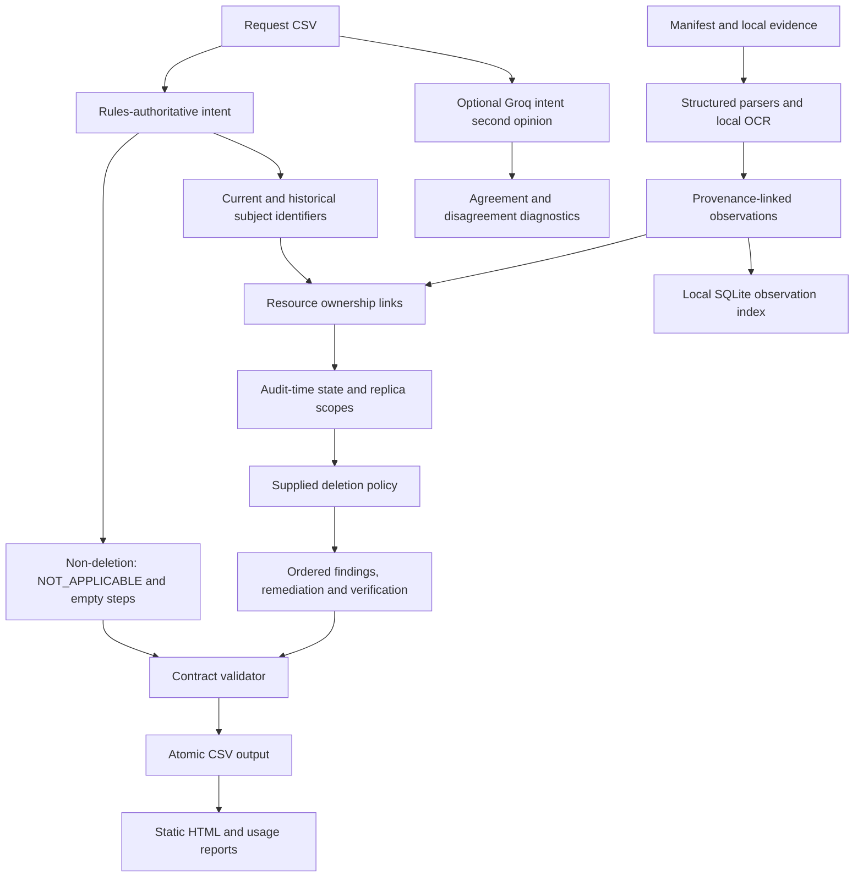

# Implemented system architecture

Date: 25 October 2026. This document describes the submitted implementation.

## Execution model

The application is a sequential Python CLI. `main.py` audits the supplied
requests and writes `output.csv`; `main.py validate` checks an existing CSV.
The agent proposes remediation and verification steps. It does not execute
remediation against external customer systems.

## Implemented components

| Component | Files | Behavior |
|---|---|---|
| CLI | `main.py` | Reads requests in input order for intent checks, loads evidence, audits cases, validates and atomically replaces the sorted CSV. |
| Intent | `audit/core.py`, `audit/llm.py`, `audit/intent_policy.json` | Rules decide authorization. The shipped policy is shadow: Groq GPT-OSS 120B supplies a second opinion and disagreement diagnostics. Explicit English refusals override a model answer. |
| Identity and ownership | `audit/core.py` | Expands current/historical emails, phones, hashes and stable references. Links records through content, completed lookup keys, resource references and workflow-window candidates. |
| Parsers | `audit/ingestion.py` | Reads JSON, text, log wrappers, PDF text and SQL snapshots. SQL is executed in an isolated in-memory SQLite connection with an authorizer. |
| Screenshot extraction | `extract_windows_ocr.ps1`, `audit/layout.py` | Uses local Windows OCR text and word geometry. Rows keep neighboring customers separate. Non-Windows execution uses the tesseract executable for text OCR. |
| State, policy and planning | `audit/core.py` | Applies cutoff, source scope, replica and deletion-rule checks; assembles only the contract's operations and states. |
| Reports | `audit/reporting.py`, `audit/llm.py` | Rebuilds the local observation index, creates a static HTML case report and writes measured usage. |
| Evaluation | `evaluation/` | Runs public sample inference before opening expected labels, executes mocked regressions, computes metrics and records the intent regression gate. |
| Packaging | `package_submission.py` | Builds code.zip with runnable sources, the actual prompt, implemented documentation and evaluation reports, excluding the corpus and caches. |

The default workflow resolver includes completion-window correlation and a
status-consistent primary-account slot. These are ownership heuristics;
reported statuses/results never establish record state. The stricter
cross-case solver in `audit/ownership.py` is available as an evaluation
experiment and is disabled by default after failing the regression gate.

## Observation and state representation

`Observation` holds system/resource/category, state, observation time,
availability time, evidence ID, store scope, extracted fields, subject links,
source locator and priority. In-memory dictionaries index resources, subjects,
snapshots and explicit resource relationships. The runtime SQLite file has
`sources` and `observations` tables plus a resource/time index; it is a local
inspection artifact, not a separate database service.

Only observations available and observed at or before a case's audit cutoff
can decide state or provide citations. Later artifacts may discover ownership
but cannot prove earlier state. Independent replica scopes are combined
conservatively. Absence needs a relevant lookup or a snapshot with applicable
coverage; an unrelated inventory does not prove deletion.

The supplied CSV policy determines DELETE, REDACT, ANONYMIZE or RETAIN.
Tombstones keep the permitted stable reference while direct identifiers are
removed. Retained security/legal records must remain present. Active data
flows and restore paths create findings and control obligations.

Incomplete cases include observed findings, proposed remediation and checks
for every linked resource. Future actions/checks have empty evidence IDs.
Complete cases contain only evidence-backed verification. A case without
sufficient completion evidence can fail rather than invent a compliant state.
Steps use fixed phase/operation ranks, then system/resource order and consecutive
numbers. The validator checks coverage, schema, allowed values and citations.

## Groq boundary and runtime state

Only request text and the system prompt are sent to Groq. The model does not
extract evidence, resolve identifiers, decide retention, establish resource
state or generate trusted steps. The default rules-authoritative mode was
retained because the primary model trial regressed on follow-up audit requests.
`--intent-mode primary` is an explicit trial; `--intent-mode rules` disables
model calls. Evaluation can persist the global shadow policy after a regression;
no per-case expected label is passed to prediction code.

The client reads GROQ_API_KEY only from its process environment. It uses urllib,
JSON object mode, temperature 0, low reasoning effort, a 512-token completion
limit, a 20-second HTTP timeout and one retry on 429/5xx. Missing credentials,
invalid JSON and failed calls leave rules authoritative. Terminal access/model
errors stop repeated live attempts in that client. API calls are sequential.

Runtime files are created under the working folder's `.runtime/`:

- `ocr/`: image-content-hashed text and versioned word-layout caches.
- `llm_cache/`: model/prompt/text-hashed parsed answers and provider token usage.
- `observations.sqlite`: source and observation inspection index.
- `ingestion.json`: per-file ingestion results.
- `run_summary.json`, `intent_decisions.json`: run usage and intent diagnostics.
- `audit_report.html`: static human-readable case report.

In-process intent memoization avoids repeated API calls and token-count inflation
when ownership checks revisit the same text. Disk response cache reuse counts
input/output tokens separately from new live tokens. Usage reports identify
live attempts, cache hits, failures, averages and estimated per-model/overall
costs using centralized provider price constants. Credentials, request headers
and model reasoning text are never stored in caches or reports.

## Setup and measured limits

Python dependencies are pypdf and Pillow. Cold Windows runs also need working
Windows.Media.Ocr, PowerShell and an OCR language. Linux/macOS need tesseract
on PATH and currently lack Windows row-layout OCR. No Groq key or prebuilt cache
is required for the rules-authoritative CLI; see README for extraction layout
and commands.

Public exact-row agreement remains 65.625%, despite 100% status accuracy and
step precision. Ownership gaps remain, OCR misses some small identifiers,
historical identity validity is not fully modeled and conditional policy
handling is not generalized beyond supported evidence categories. The local
HTML report and SQLite index expose the actual results; they are not proof of
production-wide completeness. Current measurements are in the evaluation reports.
