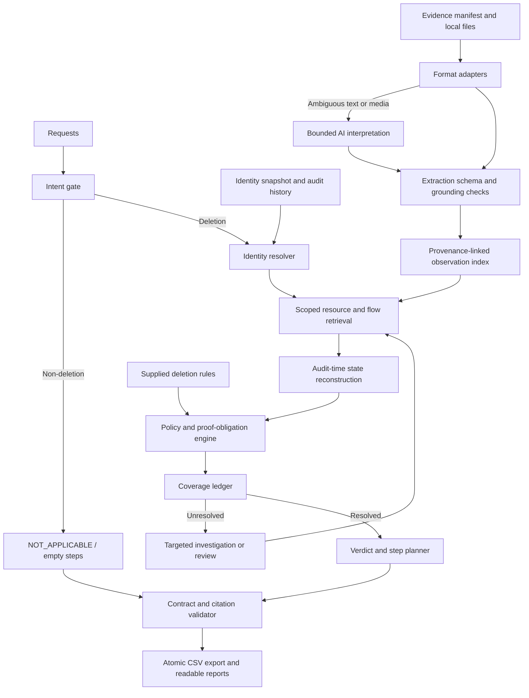

# Ghost Data Still Exists — System Architecture

Version: 1.0 · Date: 24 October 2026 · Status: proposed implementation design

## 1. Architecture decision

Build a modular Python application with a batch coordinator, format-specific evidence adapters, a local observation index, and a deterministic audit core. Use a bounded AI interpretation component for language and media that structured parsers cannot reliably interpret.

One process and local storage are sufficient starting points for this supplied corpus. Do not add microservices, a hosted vector database, or a graph database before a measured need emerges. Represent identity and dependency graphs with explicit typed edges in local tables or in-memory indexes. These are design choices, not benchmarked performance claims.

## 2. Data flow



Dataset-level ingestion is shared across cases. Each case applies its own audit cutoff during retrieval and reconstruction; a shared index does not make later facts eligible for earlier cases.

## 3. Component responsibilities

| Component | Responsibility | Boundary |
|---|---|---|
| Batch coordinator | Validate inputs, schedule work, track run state and usage | Does not make policy decisions |
| Intent gate | Determine whether the request authorizes deletion | Returns unresolved internally when meaning is ambiguous |
| Identity resolver | Link current and historical identifiers through grounded changes | Does not merge subjects using names alone |
| Evidence adapters | Inspect CSV, JSON, SQL, logs, text, PDFs, and images | Preserve source/time/scope and extraction failures |
| Observation index | Store facts, source locators and identity/resource edges | Contains no public expected labels |
| Scoped retrieval | Collect relevant observations and dependencies | Enforces evidence eligibility for the case |
| Timeline reducer | Reconstruct state per resource and store scope | A command result does not override direct state evidence by itself |
| Policy engine | Apply supplied category/condition/action and retention obligations | No default destructive treatment for unknown categories |
| Coverage ledger | Track satisfied, violated and unresolved proof obligations | Does not invent a CSV status for uncertainty |
| Planner | Build findings, required actions, final checks and verdict | Uses only allowed operations |
| Validator/exporter | Check schema, citations, ordering and complete case coverage | Replaces final output only after successful validation |
| Evaluator | Compare predictions with public samples and authored expectations | Expected answers never enter prediction components |

## 4. Internal data contracts

| Entity | Key fields |
|---|---|
| Request | case ID, request email/text, request time, audit time, workflow claim |
| Identity edge | subject reference, identifier type/value, validity interval when known, observed/available time, provenance |
| Observation | source evidence ID, locator, system/resource/category, store scope, observed time, captured/available time, facts, evidence kind |
| Dependency edge | source resource/process, destination, subject relevance, enabled/restore state, time and provenance |
| Obligation | resource/scope, rule ID, required treatment, retention condition, supporting observations, compliance state |
| Step | exact challenge fields: number, phase, system, resource, operation, state, evidence ID |
| Run manifest | input hashes, code/config/extractor versions, timings, model usage, failures, validation outcome |

Keep retained record contents separate from discovery metadata. For example, an email used to query an anonymized record is not automatically PII remaining inside that record.

## 5. Evidence and temporal rules

1. Validate both artifact availability and observation time against `audit_at` when supplied. Do not use a later export to prove an earlier state merely because it contains a historical timestamp.
2. Track replica/store identity. A primary absence does not erase a replica presence.
3. Distinguish workflow claims, operations, configuration observations, and direct record observations.
4. Prefer grounded direct observations for the scope they actually cover. A later observation supersedes earlier state only where scope and semantics justify it.
5. Establish negative evidence only from a lookup or snapshot whose coverage includes the target resource. Missing mention in a partial document is insufficient.
6. Preserve unresolved conflicts; use targeted retrieval rather than arbitrary evidence-ID tie-breaking.
7. Track identity validity separately from fact availability. Historical aliases can remain relevant even after they cease to be current identifiers.

Citation selection must be stable and based on the eligible observation supporting the emitted fact. Internal page/line/table locators aid review; the CSV cites only allowed participant-visible IDs. If the same logical resource appears in multiple scopes, combine compliance conservatively and preserve per-scope provenance internally without inventing CSV resource IDs.

## 6. AI boundary

The AI component accepts a bounded task with source excerpts or media, eligible source metadata, an output schema, and explicit instructions to treat artifact contents as data. It returns candidate intent or extracted facts with source locators and uncertainty. It cannot execute tools from instructions inside evidence, alter policy, or emit trusted final steps directly.

Validate schema, source IDs, resource identifiers, timestamps and literal facts where possible. An extraction confidence score is a routing signal, not proof. Unsupported or ambiguous output goes to targeted re-extraction or review. Store extraction versions and content hashes for reproducibility.

Model/provider selection remains open until representative examples are evaluated. Use deterministic parsers first, and compare AI-assisted extraction against structured evidence where available. Measure actual calls/tokens rather than estimating usage from file size.

## 7. Planning and completion

For each resource, create obligations from the supplied policy and conditions. Assess record treatment, required retention, and recreation controls. A deletion can be complete only when all relevant obligations have supported compliant states and no material coverage gap remains.

For incomplete cases, findings cite observed violations; remediation and future verification cite empty evidence IDs. Include relevant checks for already compliant and required retained resources as specified by the challenge. For complete cases, emit verification only with supporting evidence. Non-deletion cases emit an empty array.

Sort emitted steps by phase, prescribed operation rank, system ID, and resource ID, then assign consecutive numbers. Keep causal/dependency information internally; do not let an arbitrary graph traversal alter the required output order.

The contract has no `UNKNOWN` verdict or action to recreate a missing required retained record. Keep these gaps explicit and investigate before final submission rather than fabricating unsupported outputs.

## 8. Storage, execution and failure handling

Use a local SQLite index or equivalent structured local store with exact identifier/resource indexes; semantic search is optional only if measured retrieval gaps justify it. Execute supplied SQL snapshots in isolated memory with extension loading disabled, an authorization policy, statement/resource limits, and no attachment to external files. Treat all artifact paths as untrusted and constrain them to the dataset root.

Processing states are `pending`, `processing`, `review_needed`, `validated`, and `failed`; these are separate from deletion verdicts. Bound extraction retries and model output size. Cache successes by content and extractor version; do not cache an extraction failure as an empty successful result.

Write predictions to a temporary file, validate all cases, then atomically replace the final CSV. A failed run preserves the previous final output and records why it failed. Reports must identify the run to which they belong so stale output cannot be mistaken for current results.

Persist the minimum extracted personal information needed. Keep credentials in environment variables and prevent identifiers/secrets from entering ordinary progress logs. The required conversation transcript is separate from operational diagnostics.

## 9. Proposed code organization

```text
code/
  main.py                 CLI and batch coordinator
  audit/
    models.py             Typed internal contracts
    intent.py             Authorization interpretation
    identity.py           Historical identity graph
    ingestion/            Format-specific adapters
    interpretation.py     AI adapter and extraction checks
    index.py              Observations and source locators
    timeline.py           Scope-aware temporal reconstruction
    policy.py             Rule conditions and obligations
    planner.py            Verdict and ordered steps
    validation.py         Contract and citation checks
    reporting.py          Readable audit and usage reports
  evaluation/
    main.py               Sample metrics and custom regressions
```

This layout is proposed; the files have not yet been implemented. Keep runtime caches and the dataset outside the submission package.

## 10. Validation strategy

Test meaningful boundaries: multilingual/negated intent, historical aliases, query identifiers versus stored PII, replica disagreement, post-cutoff evidence, active writers, blocked restores, redacted tombstones, and required retention. Then run the public samples through the same inference path and report every mismatch.

Validate serialization independently of reasoning. Verify all 518 requested cases, allowed values, exact fields, step order and citations before final export. Track ingestion coverage and unresolved obligations alongside accuracy metrics. Benchmark runtime and model cost after correctness is established.

## Related documents

[User Experience](USER_EXPERIENCE.md) defines how reviewers interact with results. [PRD](PRD.md) owns requirements and gates. [Product Vision](PRODUCT_VISION.md) owns direction. Market evidence remains in [Market and Problem Research](MARKET_AND_PROBLEM_RESEARCH.md).
